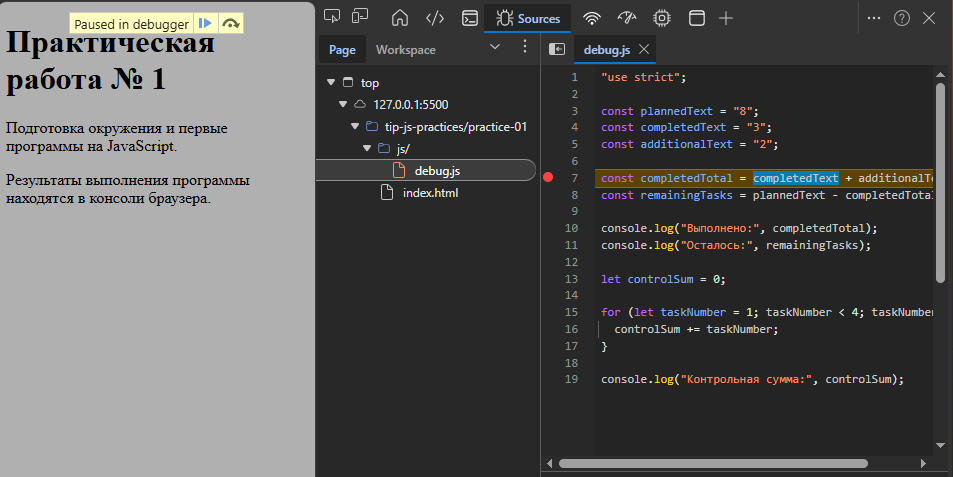

## Задание 1.
Запуск через Node.js: node practice-01/js/hello.js — вывод в терминале.
Запуск в браузере: открыт index.html, вывод в Console DevTools.

Различие последней строки:

Node.js: Тип document: undefined — среда Node.js не создаёт HTML-страницу и не предоставляет браузерный DOM.

Браузер: Тип document: object — браузер загрузил документ и предоставил объект document.

Один и тот же файл работает в обеих средах, но браузерные API доступны только в браузере.

## Задание 2. Типы и преобразования
| 1 | `"8" + 2` | `"82"` | `"82"` | string | Оператор `+` при участии строки выполняет конкатенацию: число 2 превращается в `"2"` и приклеивается к `"8"`. |
| 2 | `"8" - 2` | `6` | `6` | number | Оператор `-` не работает со строками, поэтому строка `"8"` неявно преобразуется в число 8. |
| 3 | `Number("8") + 2` | `10` | `10` | number | `Number("8")` даёт число 8, затем обычное сложение: 8 + 2 = 10. |
| 4 | `"12" > "3"` | `false` | `false` | boolean | Обе стороны — строки, поэтому сравнение посимвольное: `"1"` меньше `"3"`, значит `"12" < "3"`, а не больше. |
| 5 | `12 === "12"` | `false` | `false` | boolean | Оператор `===` строгий: не приводит типы. Число 12 и строка `"12"` — разные типы, значит `false`. |
| 6 | `Number("")` | `0` | `0` | number | Пустая строка по правилам `Number()` преобразуется в 0. Поэтому `Number("")` не подходит для проверки «пользователь ввёл число». |
| 7 | `Number("text")` | `NaN` | `NaN` | number | Строка `"text"` не является числом, `Number()` возвращает `NaN` (Not a Number). Тип при этом остаётся `number`. |
| 8 | `Boolean("false")` | `true` | `true` | boolean | Любая непустая строка даёт `true`. Строка `"false"` — непустая, поэтому `true`. Это не логическое значение `false`. |
| 9 | `typeof null` | `"object"` | `"object"` | string | Историческая особенность JavaScript: `null` — отдельное примитивное значение, но `typeof null` возвращает `"object"`. |
| 10 | `typeof NaN` | `"number"` | `"number"` | string | `NaN` имеет тип `number` (это «специальное» число). Сам `typeof ...` возвращает строку `"number"`, поэтому тип результата — string. |

## Задание 3. Сводка выполнения задач
| Проверка | totalTasks | completedTasks | Ожидание | Факт | Итог |
|---|---|---|---|---|---|
| Обычный случай | 12 | 5 | Осталось 7; 41.7%; В работе | Всего задач: 12 / Выполнено: 5 / Осталось: 7 / Прогресс: 41.7% / Статус: В работе | Пройдено |
| Нет задач | 0 | 0 | «Задач пока нет» | Задач пока нет. | Пройдено |
| Не начато | 5 | 0 | Осталось 5; 0.0%; Не начато | … | Пройдено |
| Завершено | 5 | 5 | Осталось 0; 100.0%; Завершено | … | Пройдено |
| Выполнено больше, чем всего | 5 | 6 | Ошибка | Ошибка: completedTasks … | Пройдено |
| Отрицательное | -1 | 0 | Ошибка | Ошибка: totalTasks … | Пройдено |
| Дробное | 5 | 2.5 | Ошибка | Ошибка: completedTasks … | Пройдено |
| Строка | "5" | 2 | Ошибка | Ошибка: totalTasks … | Пройдено |
| Верхняя граница | 1001 | 0 | Ошибка | Ошибка: totalTasks … | Пройдено |
| NaN | NaN | 0 | Ошибка | Ошибка: totalTasks … | Пройдено |

## Задание 4. План выполнения задач по дням
| Обычный случай | 12 | 5 | 3 | 3 дня, последний — 1 задача | … | Пройдено |
| Ровно по дням | 10 | 4 | 3 | 2 дня по 3 | … | Пройдено |
| Лимит больше остатка | 5 | 3 | 10 | 1 день, 2 задачи | … | Пройдено |
| Всё выполнено | 5 | 5 | 2 | 0 дней | … | Пройдено |
| Задач нет | 0 | 0 | 2 | 0 дней | … | Пройдено |
| Лимит 0 | 5 | 2 | 0 | Ошибка | … | Пройдено |
| Дробный лимит | 5 | 2 | 1.5 | Ошибка | … | Пройдено |
| Выполнено больше всего | 5 | 6 | 2 | Ошибка | … | Пройдено |
| Лимит строкой | 5 | 2 | "2" | Ошибка | … | Пройдено |
| Лимит > 1000 | 5 | 2 | 1001 | Ошибка | … | Пройдено |

## Задание 5. Поиск логических ошибок через DevTools
PS C:\Users\TGK\Desktop\TIP\tip-js-practices> node practice-01/js/debug.js                 
Выполнено: 32
Осталось: -24
Контрольная сумма: 6

| Ошибка | Что наблюдалось | Причина | Исправление | Результат |
|---|---|---|---|---|
| Обработка количества задач | `completedTotal = "32"` (тип string), `remainingTasks` = неверное число | Оператор `+` для строк делает конкатенацию, а не сложение | Обернуть оба операнда в `Number()` | `completedTotal = 5`, `remainingTasks = 3` |
| Граница цикла | `controlSum = 6` вместо 10 | Условие `taskNumber < 4` обрывает цикл на 3, пропуская 4 | Заменить `< 4` на `<= 4` | `controlSum = 10` |

**Как отлаживал:** в DevTools → Sources поставил точку останова на строке `const completedTotal = ...`.
В Scope было видно, что `completedText` и `additionalText` — строки (`"3"`, `"2"`).
После шага Step over тип `completedTotal` оказался `string`, значение `"32"` — подтверждение ошибки.

